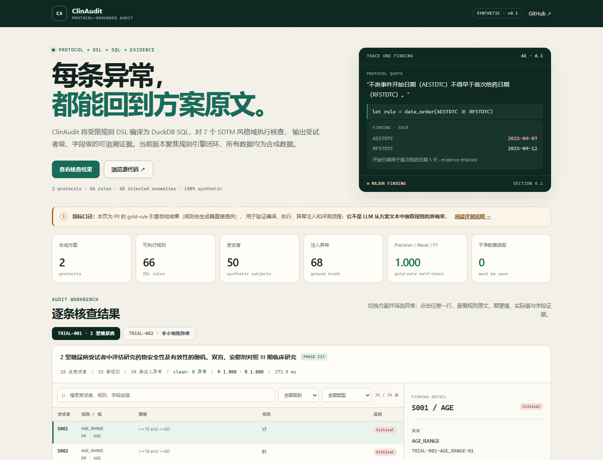
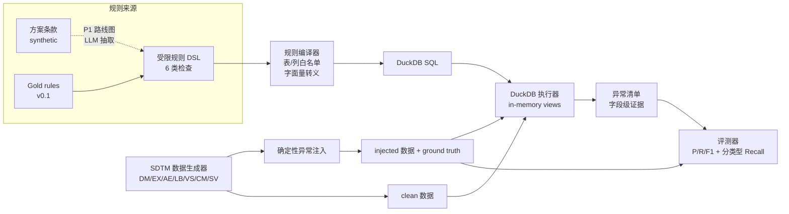

# ClinAudit Agent

**把临床试验方案条款编译为可执行 SQL 核查规则，对 SDTM 风格数据输出带证据链的异常清单。**

[](LICENSE)
[](pyproject.toml)
[](https://duckdb.org/)
[](#边界与局限)

[交互演示](https://caosheng-hub.github.io/clin-audit-agent/) · [评测报告](reports/evaluation.md) · [规则示例](#一个规则长什么样) · [路线图](#路线图)

[](https://caosheng-hub.github.io/clin-audit-agent/)

> ClinAudit is a reproducible prototype for protocol-grounded clinical data auditing. It compiles a constrained rule DSL into DuckDB SQL, audits SDTM-style domains, and returns subject-level anomalies with protocol quotes and field-level evidence. The v0.1 benchmark uses 100% synthetic data and generator-provided **gold rules** to validate the rule engine itself; LLM-based protocol extraction is the next milestone, not a current claim.

## 项目解决什么问题

临床试验数据核查通常需要把方案中的入排标准、访视窗口、不良事件逻辑和合并用药限制，人工翻译成一条条检查程序。这个过程重复、容易产生口径差异，而且往往只留下"哪条数据异常"，没有留下"依据方案哪一句、字段证据是什么"。

ClinAudit 的做法是：

- 用**受限规则 DSL** 表达可核查条款，而不是让模型直接生成自由 SQL；
- 将规则编译为 DuckDB SQL，在 7 个 SDTM 风格域上执行；
- 每条异常都保留受试者、规则、字段、期望值、实际值和证据链；
- 用确定性异常注入构造 ground truth，自动计算 Precision / Recall / F1 和分类型召回；
- 对被检查的干净数据单独运行一遍，确认引擎不会凭空报错。

## 一览

| 项目 | 当前状态 |
|---|---|
| 版本 | v0.1（P0 规则引擎闭环） |
| 输入 | 合成方案条款、7 个 SDTM 风格 CSV 域 |
| 规则 | 每个方案 33 条，覆盖 6 类检查 |
| 数据 | 2 个方案 × 25 名受试者，全部为合成数据 |
| 评测集 | 每个方案注入 34 条已知异常，共 68 条 |
| 执行引擎 | DuckDB，内存数据库，只读查询 |
| 输出 | 异常 JSON、分方案评测 JSON、Markdown 评测报告 |
| 测试 | 规则覆盖、SQL 安全、零误报、端到端确定性 |

当前版本**不包含**从 PDF 或自然语言方案中自动抽取规则的 LLM 流水线。`clinagent/llm/provider.py` 只保留了本地 Ollama 适配接口，供下一阶段使用。

## 评测结果

在固定随机种子下，对 2 个合成方案分别执行 clean 和 injected 数据集：

| 方案 | 规则数 | 受试者 | 注入异常 | TP | FP | FN | Precision | Recall | F1 | clean 检出 |
|---|---:|---:|---:|---:|---:|---:|---:|---:|---:|---:|
| TRIAL-001 | 33 | 25 | 34 | 34 | 0 | 0 | 1.0000 | 1.0000 | 1.0000 | 0 |
| TRIAL-002 | 33 | 25 | 34 | 34 | 0 | 0 | 1.0000 | 1.0000 | 1.0000 | 0 |
| **合计** | **66** | **50** | **68** | **68** | **0** | **0** | **1.0000** | **1.0000** | **1.0000** | **0** |

**指标口径很重要：** 这里的 100% 是"规则编译器 + SQL 执行器 + 注入器 + 评测器"在 gold rules 上的闭环自检，不代表 LLM 从方案文本中抽取规则的准确率。异常注入器与规则集使用同一套规则定义，因此满分是预期中的引擎正确性结果，而不是模型能力结果。LLM 抽取指标会在 P1 单独报告，不能与这组数字混用。

完整结果见 [reports/evaluation.md](reports/evaluation.md)，逐条异常见 [reports/TRIAL-001_anomalies.json](reports/TRIAL-001_anomalies.json)。

## 工作流



工具链刻意把"规则表达"和"规则执行"分开：

1. 规则先经过 schema 校验，只允许白名单表、列和参数；
2. SQL 字面量统一转义，标识符由编译器生成，不直接拼接用户输入；
3. 执行器在内存 DuckDB 中为 7 个 CSV 建视图，再逐条运行规则；
4. 查询返回受试者级异常，评测器按 `(subject_id, rule_id)` 与 ground truth 对齐；
5. clean 数据集单独执行，任何检出都计为误报。

## 一个规则长什么样

规则以 JSON 存储，核心字段如下：

```json
{
  "rule_id": "TRIAL-001-AESTDTC_AFTER_DOSE-17",
  "trial_id": "TRIAL-001",
  "code": "AESTDTC_AFTER_DOSE",
  "domain": "AE",
  "field": "AESTDTC",
  "check_type": "date_order",
  "params": {
    "left_field": "AESTDTC",
    "op": ">=",
    "right": { "source": "dm", "field": "RFSTDTC" }
  },
  "severity": "major",
  "section_id": "6.1",
  "section_title": "不良事件",
  "quote": "不良事件开始日期（AESTDTC）不得早于首次给药日期（RFSTDTC）。"
}
```

对应异常会保留可回查的证据：

```json
{
  "subject_id": "S018",
  "rule_id": "TRIAL-001-AESTDTC_AFTER_DOSE-17",
  "domain": "AE",
  "field": "AESTDTC",
  "expected": "AESTDTC >= RFSTDTC",
  "actual": "AESTDTC=2025-04-07, RFSTDTC=2025-04-12",
  "evidence": "AESTDTC=2025-04-07, RFSTDTC=2025-04-12",
  "severity": "major"
}
```

规则类型与覆盖范围：

| 类型 | 用途 | 示例 |
|---|---|---|
| `range` | 数值范围 | 年龄 18–80 岁、BMI ≥ 19、ALT 上限 |
| `required` | 必填校验 | AESEV、SVSTDTC、CMTRT 非空 |
| `date_order` | 日期先后关系 | AE 开始日期不得早于首次给药日期 |
| `visit_window` | 访视窗口 | V2 第 14 天 ±3 天 |
| `consistency` | 跨字段逻辑 | 导致停药必须标记 SAE；SAE 严重程度必须为 SEVERE |
| `conmed_prohibited` | 禁用合并用药 | 方案禁用华法林/利伐沙班 |

## 快速开始

要求 Python 3.10+。以下命令在仓库根目录运行：

```bash
git clone https://github.com/caosheng-hub/clin-audit-agent.git
cd clin-audit-agent

python -m venv .venv

# Windows
.venv\Scripts\activate
# macOS / Linux
# source .venv/bin/activate

python -m pip install -e ".[dev]"
python -m pytest -q

# 生成合成数据、执行核查并输出评测报告
python -m clinagent.cli all
```

仓库中的数据由固定 seed=42 生成，可直接复现；完整测试覆盖规则覆盖、SQL 安全、零误报与端到端确定性。项目要求 Python 3.10+。

只想查看某一份数据：

```bash
# 注入异常集：应检出 34 条
python -m clinagent.cli check --trial TRIAL-001 --dataset injected

# 干净数据：应检出 0 条
python -m clinagent.cli check --trial TRIAL-001 --dataset clean
```

运行后产生：

```text
data/synthetic/TRIAL-001/protocol.md      合成方案文本
data/synthetic/TRIAL-001/rules.json       规则 DSL
data/synthetic/TRIAL-001/clean/           干净数据
data/synthetic/TRIAL-001/injected/        注入异常后的数据
data/synthetic/TRIAL-001/ground_truth.json 异常标准答案
reports/evaluation.md                     评测报告
reports/TRIAL-001_anomalies.json          异常明细（clean + injected）
```

示例数据与报告已提交到仓库，因此不运行代码也可以直接审阅结果；重新运行会按固定 seed 重建数据，并刷新报告时间戳。

## 目录结构

```text
clinagent/
  generator/
    protocol.py      # 合成方案、条款与 gold rule DSL
    sdtm.py          # 7 个 SDTM 风格域的数据生成
    injector.py      # 6 类异常注入与 ground truth
  rules/
    compiler.py      # DSL -> SQL，表/列白名单与参数校验
    executor.py      # DuckDB 只读执行与计时
    evaluator.py     # P/R/F1、分类型召回、FP/FN 明细
  llm/
    provider.py      # Ollama / Mock 适配器（P1 预留）
  pipeline.py        # 生成、执行、评测编排
  cli.py             # 命令行入口
  schema.py          # Pydantic 规则与异常模型
tests/
  test_pipeline.py
scripts/
  build_demo.py      # 从真实报告生成 docs/demo-data.js
  setup_ollama.ps1   # 下一阶段本地 LLM 的环境辅助脚本
docs/
  index.html         # 静态核查演示页
  demo-data.js       # 由评测报告生成的前端数据
  assets/            # README 截图
data/synthetic/      # 可复现的合成数据与标准答案
reports/             # 已提交的评测产出
```

## 工程与安全边界

- **LLM 不直接写 SQL**：当前执行层只接受受限 DSL。即使未来加入 LLM 抽取，模型也只负责产生结构化规则，不直接接触数据库执行。
- **白名单编译**：表、列、操作符和参数都经过显式校验；非法标识符在编译阶段失败，不会进入 SQL。
- **只读执行**：DuckDB 使用内存数据库，CSV 仅作为视图读取，不修改原始数据。
- **可追溯证据**：异常和规则都带方案章节、原文引用、期望值、实际值和字段证据。
- **确定性评测**：数据生成和异常注入均由固定 seed 控制；当前指标可重复。
- **边界声明**：P0 不是生产级临床系统，也不构成医疗、合规或申报建议。

## 边界与局限

- **没有 LLM 抽取指标**：当前规则来自生成器的 gold rules，不能把 100% 当作"方案自动理解"或"Agent 准确率"。
- **数据是合成的**：真实世界中的脏数据、单位换算、自由文本、缺失访视、方案偏离和跨表单一致性远比合成集复杂。
- **规则集有限**：6 类检查、33 条规则/方案、7 个域，不是完整 CDISC/SDTM 校验套件。
- **匹配口径较严格**：评测按 `(subject_id, rule_id)` 对齐，同一受试者的同一规则异常会被合并为一条。
- **未做生产规模压测**：当前 benchmark 只验证正确性和可复现性，不声称具备生产吞吐。
- **没有临床审核工作台**：演示页用于结果审阅，不是经合规验证的 EDC/数据管理平台。

## 路线图

- **P1：方案抽取层**
  用本地 LLM 从章节文本中抽取受限 DSL，要求引用回查和 schema 校验，并单独评测条款级与参数级抽取指标。
- **P2：跨域调查 Agent**
  对异常做跨域证据检索（AE/EX/LB/DM/CM），生成带引用的人工可审调查摘要与 query 草稿，不自动关闭异常。
- **P3：复核工作台与规模验证**
  增加异常筛选、人工处置、审计日志和更大规模数据的性能基线。

## 来源与声明

本项目源于本人在临床数据管理相关实习中接触的业务问题。仓库中的实现、方案文本和数据均为独立整理的合成演示，不包含雇主的源代码、内部文档、真实试验方案或患者数据，也不代表任何机构的生产系统或效果。代码以 MIT License 发布，仅供技术交流和方法验证。

维护者：[caosheng-hub](https://github.com/caosheng-hub)
